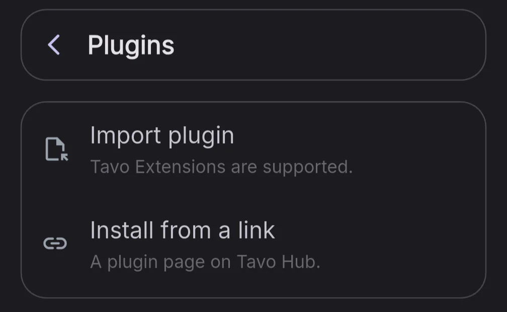
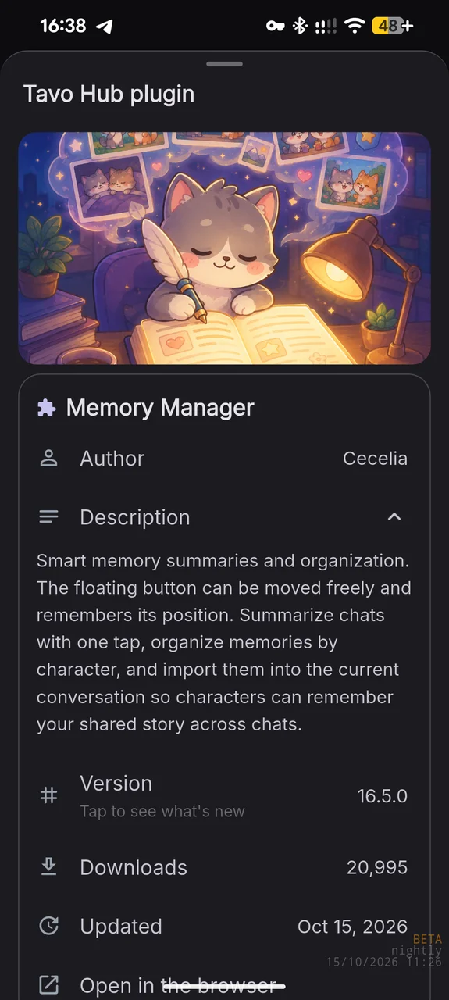
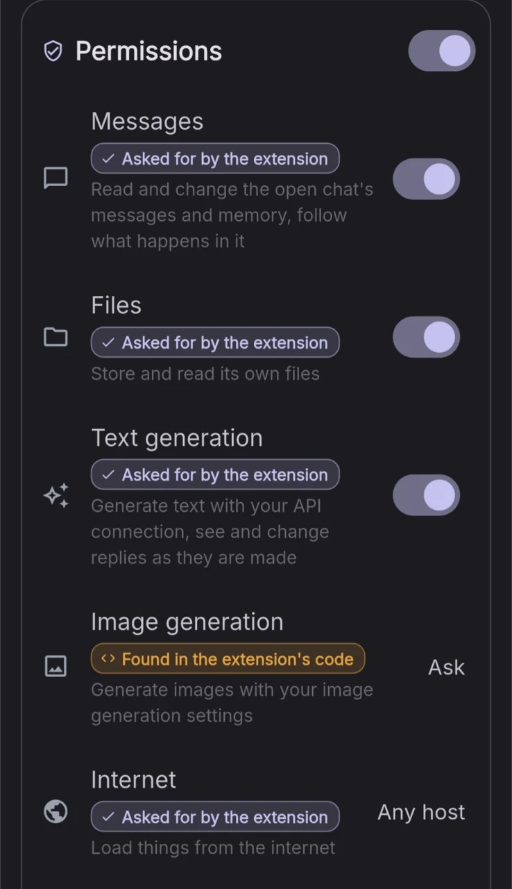
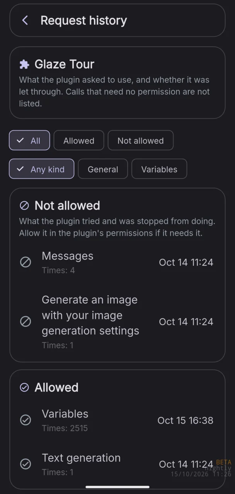
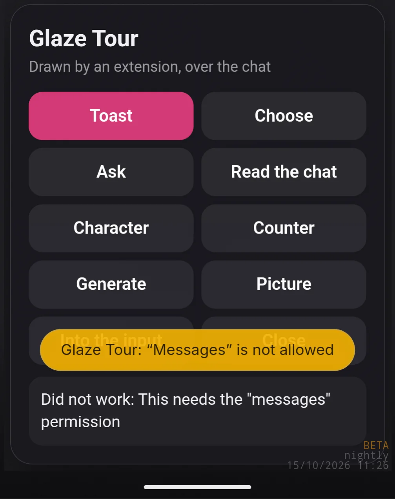
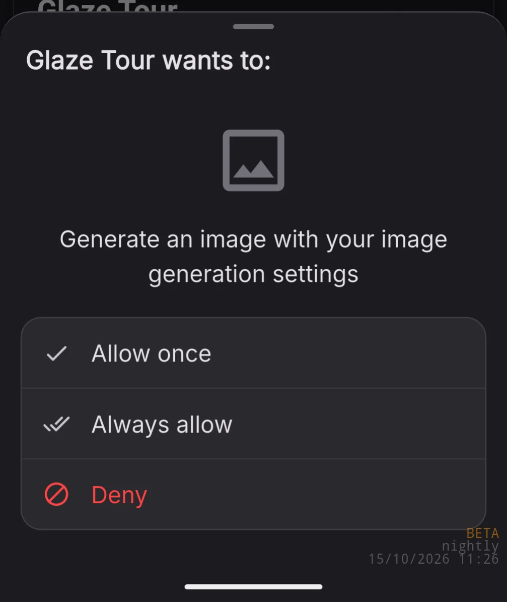
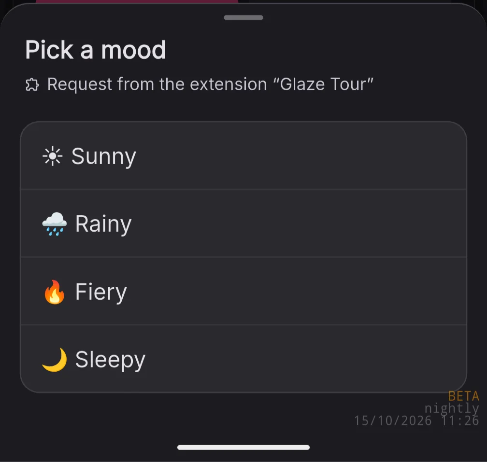
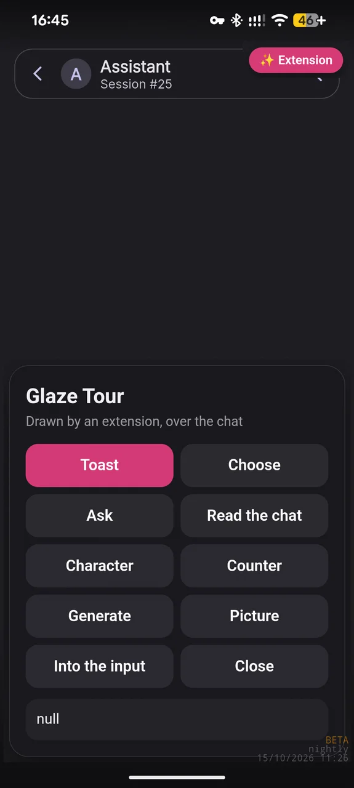
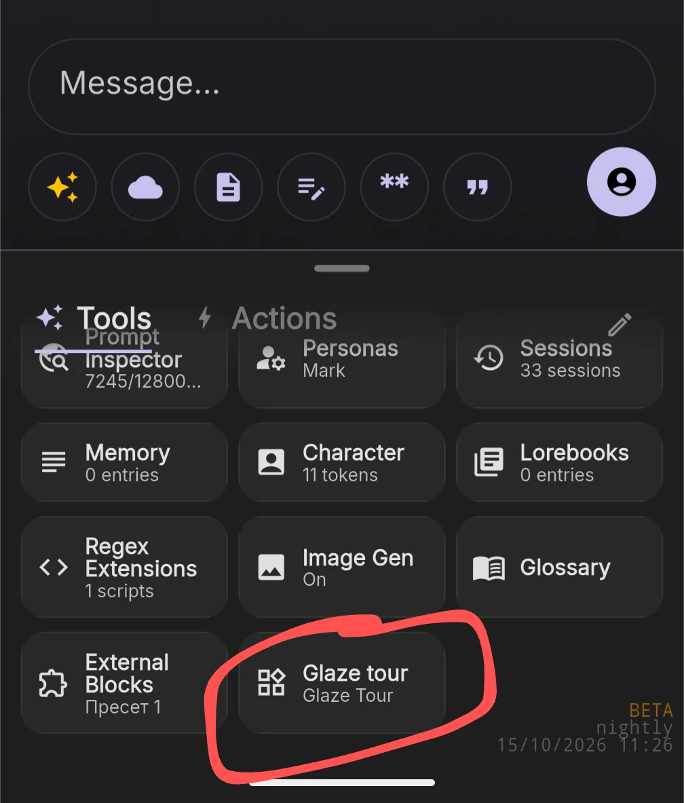
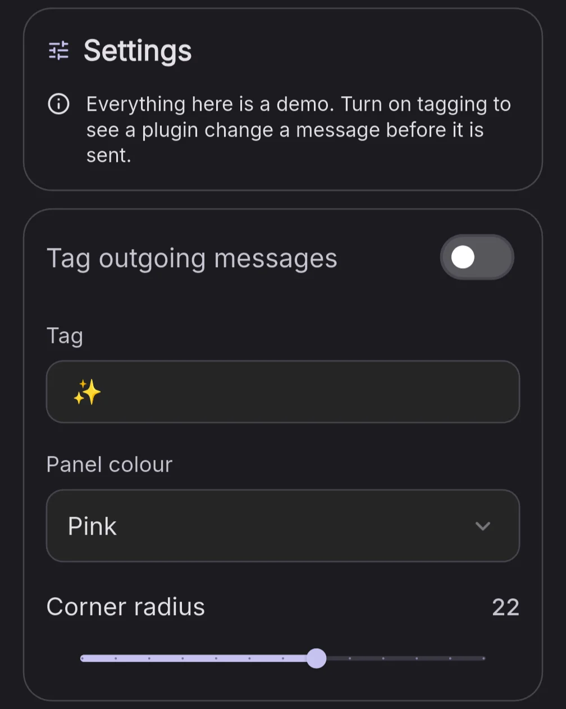

this one got put off for a long time, but I finally got to it, and it wasn't that painful

**HEADS UP!** Everything below is still on the test branch. Any of it may change.

## What was done

Glaze now has its own framework that gives plugin authors more to work with, without compromising users' privacy.

It is already being tested on Nightly (the branch for developers and testers). You can try it yourself by [downloading Nightly from the site](#download/nightly). It installs next to regular Glaze and does not share data with it. It is a test build, so you may lose app data.

### Tavo extension compatibility

Plugin pages from Tavo Hub open right inside Glaze, and .tpg files can be imported directly. On import the plugin is converted to the Glaze format. The plugin never finds out it is not running in Tavo.

### Permission matrix

Plugins (Tavo or Glaze, it makes no difference) do not get free rein over the whole app. You decide by hand what a plugin can reach, down to individual websites, so your data does not leak anywhere unexpected.

If you denied a plugin something and it tries to get at it anyway, Glaze will tell you.

Every model request for an image or a message can also be put behind a confirmation.

Plugins can ask you for input directly through Glaze's own interface.

### Full access to the interface, no access to the chat

In Tavo every extension gets the whole chat right away, bypassing the extension bridge. In Glaze each plugin runs in its own frame and can talk to the chat only through the framework (the communication bridge). That gives the best of both worlds: plugins can draw their own interfaces over the chat and add buttons to Glaze's interface, but cannot mess with the chat or with other plugins (in Tavo all plugins share one chat).

### Settings

Plugins can create their own settings in their own menu. Localization into different interface languages is fully supported.

## For developers

Full documentation will be published closer to the 0.9.0 release, but here is what stands out:

### glaze.net.fetch

A framework method. There is no need to route traffic through relays to get around CORS: calls go straight from Glaze, with the user's permissions and the headers you set.

### Your requests

I'm happy to add whatever makes life easier for people creating content for Glaze. If you have requests, come to the dedicated "creators" topic in the [Glaze chat](https://t.me/glazeappcommunity).

## When is it coming?

Plugins are planned to ship this weekend.
