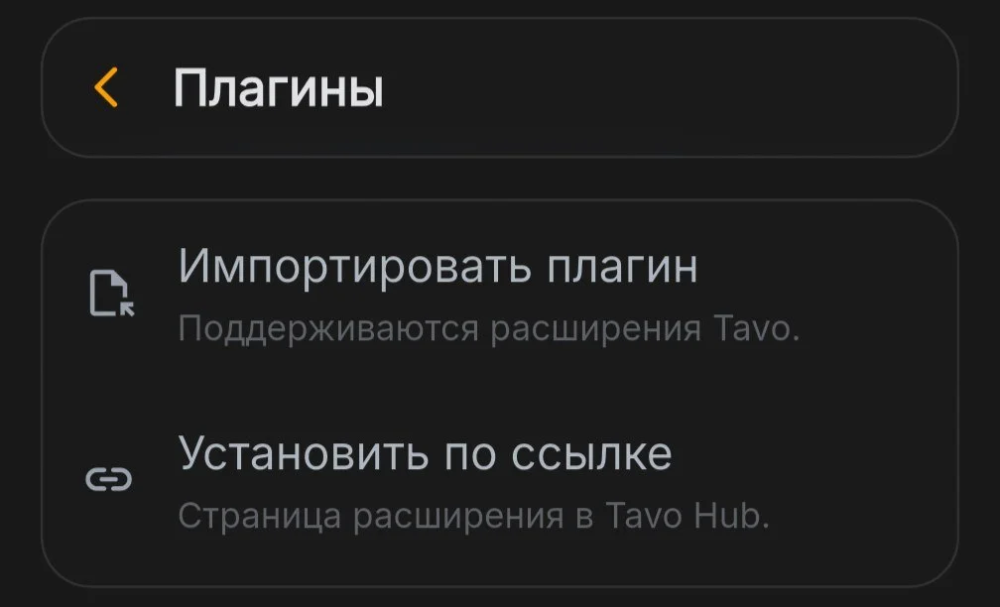
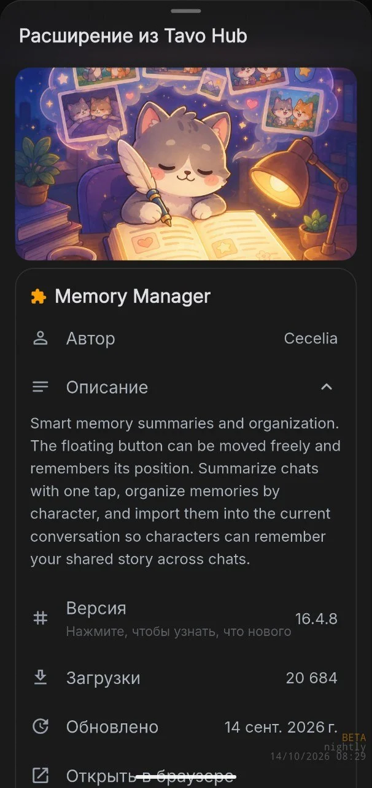
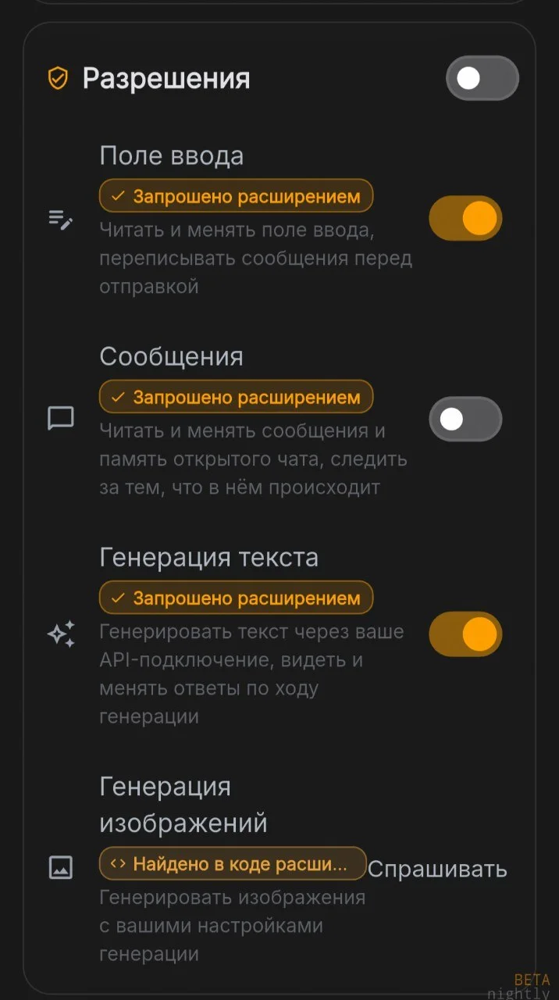
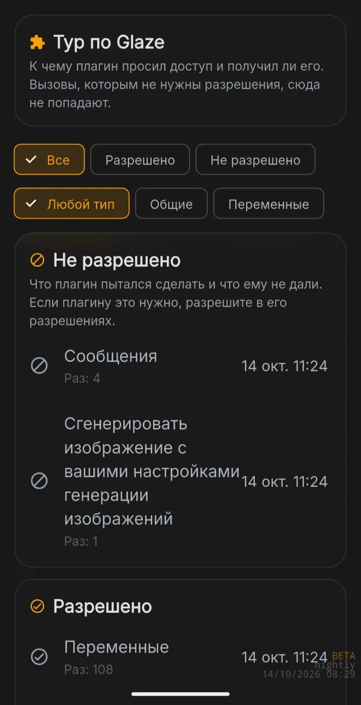
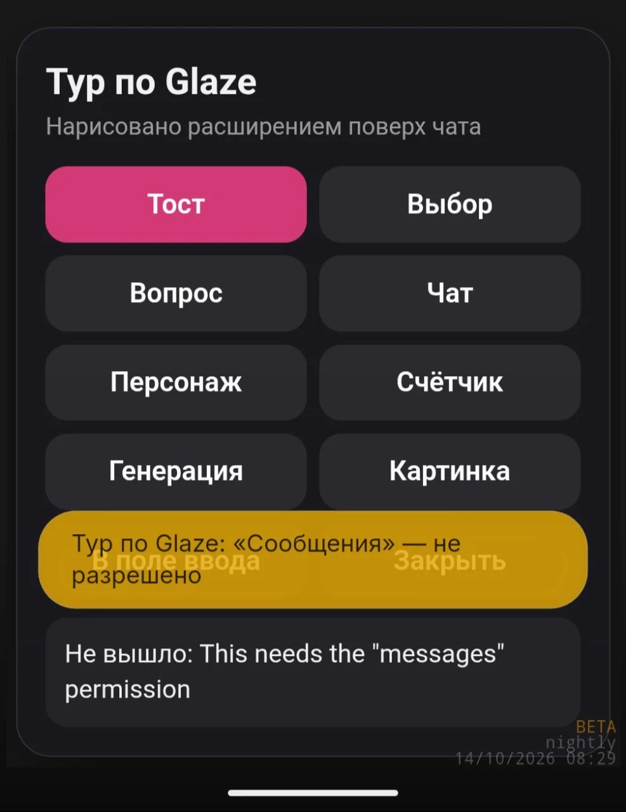
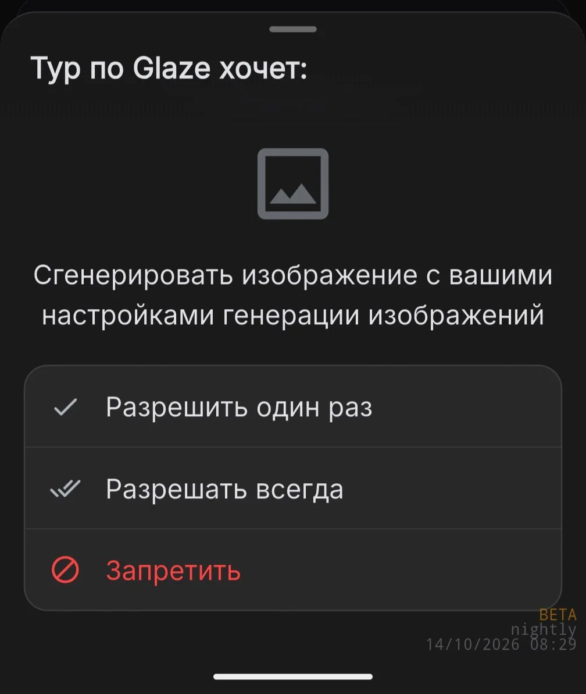
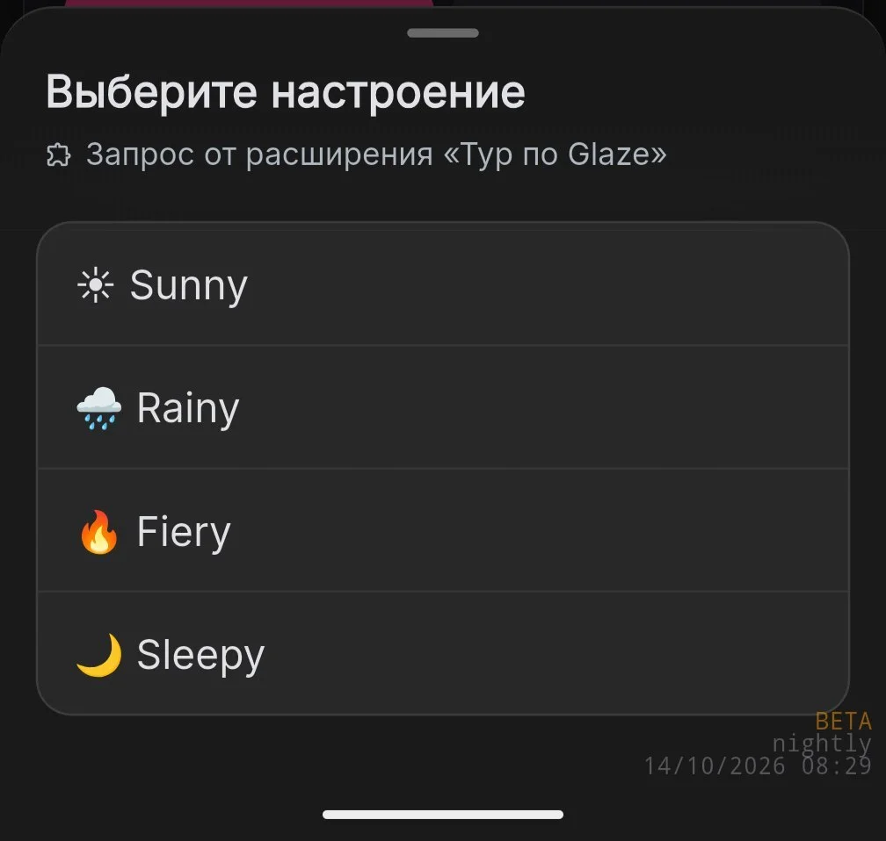
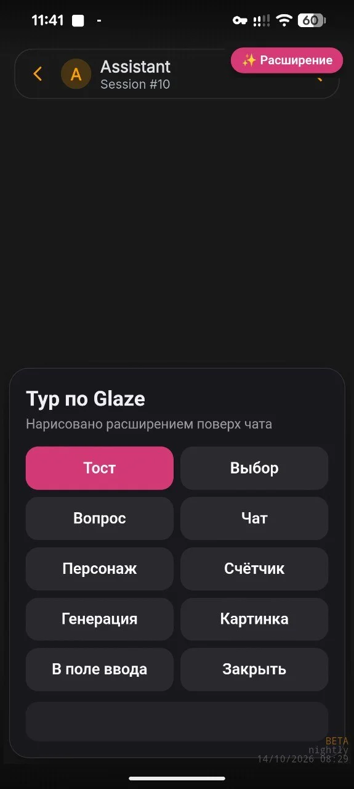
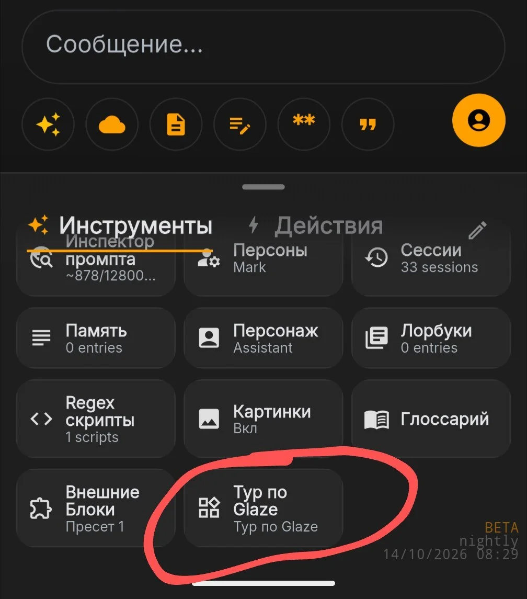
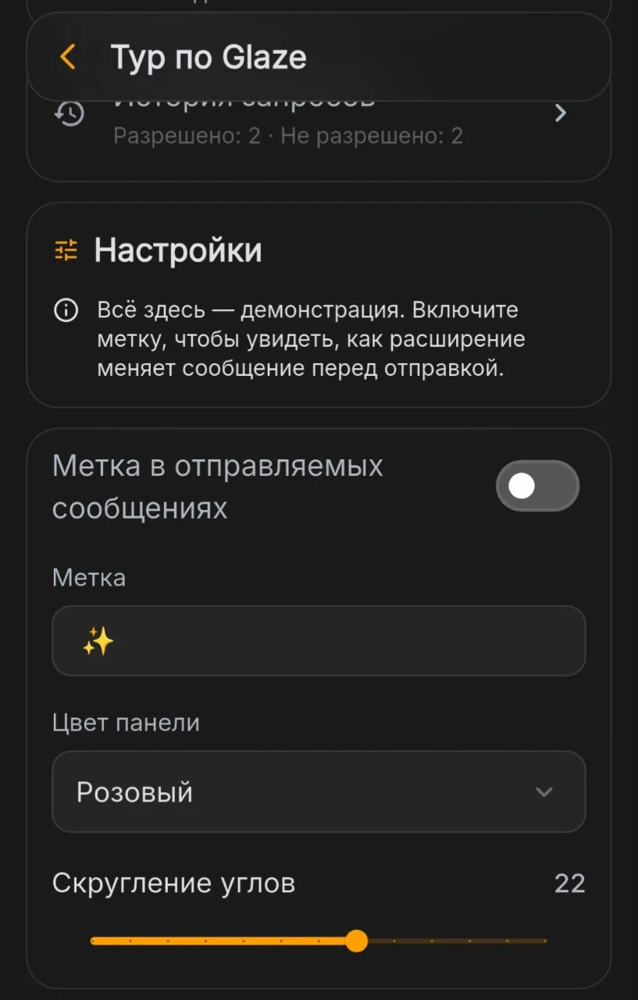

вопрос этот игнорировался долго, но у меня таки дошли руки, и это было не так больно

**ВНИМАНИЕ!** Весь упомянутый ниже функционал всё ещё находится на тестовой ветке. Любая упомянутая особенность может измениться.

## Что было сделано

Был создан собственный фреймворк, призванный дать больше возможностей создателям плагинов, но в то же время не скомпрометировать приватность пользователей.

На Nightly (ветке для разработчиков и тестеров) функционал уже тестируется. Вы можете опробовать его самостоятельно, [скачав Nightly с сайта](#download/nightly). Она установится рядом с обычной Глазурью и не будет делить с ней данные. Это тестовая версия, так что есть риск потери данных приложения.

### Совместимость с расширениями Таво

Страницы плагинов из Tavo Hub открываются прямо в Glaze, файлы .tpg можно импортировать напрямую. После импорта плагин конвертируется в формат Glaze. Плагин никогда не узнает, что работает не в Tavo.

### Матрица разрешений

Плагины (не важно, Tavo или Glaze) не имеют карт-бланш на весь функционал приложения — вы вручную определяете, к чему приложение получит доступ, вплоть до отдельных сайтов, чтобы избежать неожиданных утечек ваших данных.

Если вы в чём-то отказали приложению, и оно попыталось это «что-то» вытащить — Глазурь вам об этом сообщит.

Каждый запрос модели на генерацию картинки/сообщения также можно закрыть за подтверждением

Плагины умеют запрашивать у вас информацию напрямую через интерфейс Глазури

### Полный доступ к интерфейсу без доступа к чату

В отличие от Таво, где каждое расширение сразу же получает доступ ко всему чату в обход моста для расширений, в Глазури каждый плагин работает в своём фрейме и может общаться с чатом только через фреймворк (коммуникационный мост). Итого мы имеем лучшее из двух миров — плагины могут рисовать свои интерфейсы поверх чата и добавлять кнопки в интерфейс Глазури, но без возможности пакостить в чате и другим плагинам (ведь все плагины в Таво делят общий чат)

### Настройки

Плагины без проблем могут создавать свои настройки в своём меню. Есть полная поддержка локализации для разных языков интерфейса.

## Для разработчиков

Полная документация будет опубликована ближе к релизу 0.9.0, но из примечательного:

### glaze.net.fetch

Метод из фреймворка. Нет никакой необходимости пускать трафик через рилеи для обхода CORS — можно делать вызовы напрямую из Глазури, с учётом разрешений от пользователя, с указанными заголовками.

### Ваши пожелания

Я с радостью добавлю функционал, который упростит жизнь создателям контента для Глазури. Если у вас есть пожелания — приглашаю в выделенный топик «креаторы» в [чате Глазури](https://t.me/glazeappcommunity).

## Когда выйдет?

Функционал плагинов планируется к выходу на этих выходных.
